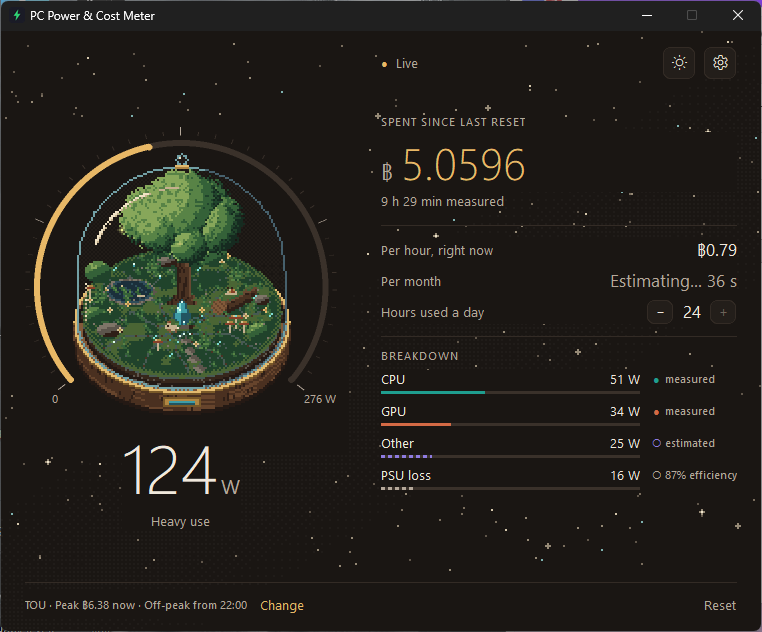
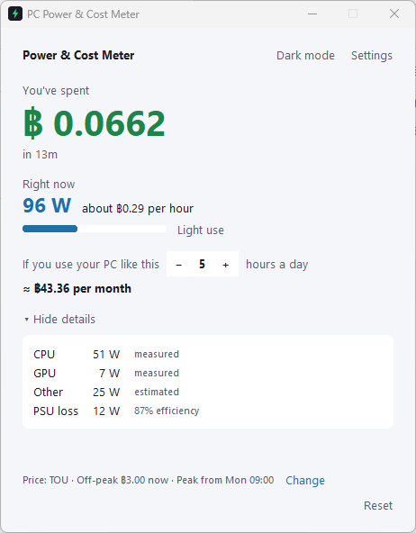
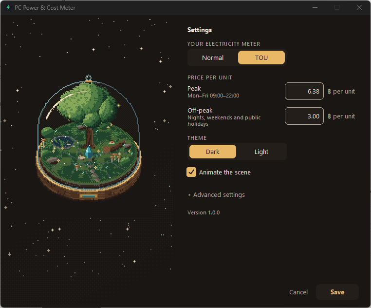
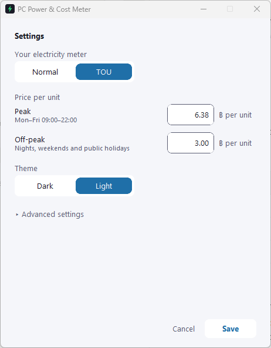

# PC Power & Cost Meter

[](https://github.com/Tachsakorn/pc-power-cost-meter/actions/workflows/ci.yml)

A small Windows app that shows how much power your PC draws from the wall right now and what it
is costing you in Thai Baht, with the total ticking up as you use it.

It runs fully offline, needs no administrator rights and no helper software, and tells you which
numbers come from real sensors and which are estimates.

<p align="center">
  
  
</p>
<p align="center">
  
  
</p>

## Features

- **Live cost meter.** Total spent to four decimal places (฿ 1.2847), current wall power in watts,
  and the cost per hour at the current price.
- **Measured where possible, estimated where not.** CPU power comes from the processor's own power
  counters, GPU power from the AMD or NVIDIA driver, and a laptop on battery uses the battery's
  discharge rate. Anything that cannot be measured is estimated, and the breakdown labels every
  part as *measured* or *estimated*.
- **Normal and TOU meters.** Prices for the standard progressive tariff and the Time-of-Use tariff,
  including Thai public holidays that are billed at the off-peak rate.
- **Monthly estimate.** "If you use your PC like this 5 hours a day: ≈ ฿167 per month", based on
  the current session.
- **A scene that follows the load.** A pixel-art glass dome with a tree and a glowing core sits
  next to the numbers. It has four states: idle, active, high load and "waiting for live data". The
  core brightens and more particles flow as the load rises, and the scene goes grey when there are
  no readings, so it never shows a state the app has not measured.
- **Earth and amber themes, dark and light.** Dark has a starry backdrop and light a daytime one;
  switch at any time. The tick gauge shows the current load against this PC's maximum.
- **Calm by choice.** The scene animates at 8 frames per second and stops while the window is
  minimised. Turn it off under **Settings → Animate the scene**; it also stays still when Windows'
  *Animation effects* setting is off.
- **Offline and private.** No network access, no telemetry, no account. Settings and totals stay in
  a few small files on your PC.
- **No administrator rights.** Runs as a standard user and never shows a UAC prompt.
- **Zero setup.** Starts counting as soon as it opens, with sensible defaults for desktops and
  laptops.

## Download and run

1. Open the [Releases](https://github.com/Tachsakorn/pc-power-cost-meter/releases) page and
   download `PCPowerCostMeter.exe` and `SHA256SUMS.txt` from the latest release.
2. Put the exe in a folder of your choice, for example `Documents\PCPowerCostMeter`. Settings and
   totals are saved next to it (see [Privacy](#privacy)).
3. Double-click `PCPowerCostMeter.exe`. There is nothing to install.

For 64-bit Windows 10 and 11; tested on Windows 11 25H2 (see [Tested on](#tested-on)).

To check which version you have, open Settings: the version is shown at the bottom. In Explorer,
right-click the exe, choose Properties, then the Details tab to see its file version.

### "Windows protected your PC"

The exe is not code-signed (signing certificates are paid and out of scope for this project), so
Windows SmartScreen warns about it the first time you run it. Click **More info**, check that the
app name is `PCPowerCostMeter.exe`, then click **Run anyway**.

Antivirus software occasionally flags unsigned programs packed with PyInstaller even when they are
harmless. To make the build easy to check, every release exe is built by GitHub Actions from the
tagged source code, without UPX compression, and its SHA-256 hash is published next to it.

### Verify the download

Open Command Prompt or PowerShell in the download folder and run:

```
certutil -hashfile PCPowerCostMeter.exe SHA256
```

The long hexadecimal string it prints must match the one in `SHA256SUMS.txt`. If it does not,
delete the file and download it again from the Releases page.

## Using it

The window is a fixed 760 × 600: the scene on the left, the dashboard on the right. Settings
replaces the dashboard and leaves the scene in view.

- **The gauge** shows wall power (averaged over the last three seconds so the number is readable)
  with a usage level from *Idle* to *Gaming-level use*. Its ticks fill from 0 W to the most this PC
  is expected to draw, which is printed at the right end of the scale.
- **The scene** switches between *Idle*, *Active* and *High load* by how much of that maximum the PC
  is drawing, and shows *Waiting for live data* while there are no readings. The caption under the
  dome names the state; hover over the dome for the exact reading.
- **Spent** is the running total, kept across restarts, with the time it covers. **Reset** sets it
  back to zero; click it a second time within 3 seconds to confirm.
- **Per hour**, **per month** and **hours a day** give the cost at the current price and the
  monthly estimate; the stepper sets how many hours a day you use the PC.
- **Breakdown** lists CPU, GPU, other components and power-supply loss, each marked *measured*
  (filled dot) or *estimated* (hollow dot).
- **Settings** sets your meter type and price, the theme, whether the scene animates, and under
  **Advanced settings** the hardware values used in the formulas below. Advanced settings also shows
  the folder the app saves to. The sun or moon button next to Settings switches between light and
  dark.

### Setting your electricity price

Under **Settings → Your electricity meter**, choose **Normal** or **TOU**.

- **Normal:** pick the band that matches your household's monthly usage. "Units used" is printed on
  your electricity bill. If you are unsure, keep "I don't know" (฿4.50). **Custom price…** accepts
  any rate in baht per unit.
- **TOU:** enter your peak and off-peak rates.

All prices are *all-in* baht per unit (kWh): the energy charge plus the Ft adjustment, plus 7% VAT.
The fixed monthly service charge is left out because it does not change with PC use.

The defaults come from the MEA/PEA residential tariff for bills from September 2026, with
Ft = +0.1623 ฿/unit (September–December 2026 billing period):

| Option in the app | Tariff tier used | Energy charge | + Ft | × 1.07 VAT = default |
|---|---|---|---|---|
| Normal, up to 200 units a month | 26–200 units | 3.0000 | 3.1623 | 3.38 |
| Normal, 201–400 units a month | 201–400 units | 4.1584 | 4.3207 | 4.62 |
| Normal, over 400 units a month | over 400 units | 4.3583 | 4.5206 | 4.84 |
| TOU peak | peak | 5.7982 | 5.9605 | 6.38 |
| TOU off-peak | off-peak | 2.6369 | 2.7992 | 3.00 |

"I don't know" uses 4.50, a rounded figure between the bands rather than a rate from the tariff
table.

Ft is revised every four months and the app never updates prices by itself, so check these
against your latest bill and change them in Settings when they differ.

## How the numbers are calculated

### Where the readings come from

The app samples once per second on a background thread and picks the best available source for
each part of the PC when it starts.

| Part | Measured source | Fallback when it can't be measured |
|---|---|---|
| CPU | RAPL package power, read from the Windows *Energy Meter* performance counters (PDH), summed over all CPU packages | Estimate from `% Processor Utility` |
| AMD discrete GPU | AMD Display Library (ADL) PMLog sensor `PMLOG_BOARD_POWER`, the total board power | Estimate from 3D engine load |
| NVIDIA GPU | NVML power usage through NVIDIA's `nvidia-ml-py` bindings | Estimate from 3D engine load |
| Laptop on battery | Battery discharge rate reported by the battery driver | Component sum below |
| Motherboard, RAM, drives, fans | Not measured; learned on battery on a laptop | Fixed value (*Other components*) |
| Monitor, speakers | Not measured; powered separately | Fixed value you add (*Monitor & extras*) |

Integrated and software graphics adapters are identified with Microsoft's DXCore API and left out
of the GPU estimate. An integrated GPU shares the processor's power budget, so its power is
generally already part of the CPU package reading. When DXCore finds no discrete GPU, the
breakdown shows the GPU as *included in CPU* and the usage level is judged against the CPU's power
budget alone.

A reading outside 0–1000 W counts as a failed read. A measured source that fails three reads in a
row is replaced by its estimate and retried every 60 seconds.

### Wall power

Plugged in, the parts are added up and divided by the efficiency of the power supply (or laptop
charger), because the wall delivers more than the parts consume:

```math
P_{\mathrm{dc}} = P_{\mathrm{cpu}} + P_{\mathrm{gpu}} + P_{\mathrm{other}}
\qquad
P_{\mathrm{wall}} = \frac{P_{\mathrm{dc}}}{\eta_{\mathrm{psu}}} + P_{\mathrm{extra}}
```

On battery, the battery's discharge rate already covers the whole laptop. That energy is paid for
later when the battery is recharged, so the charging loss is included:

```math
P_{\mathrm{wall}} = \frac{\lvert P_{\mathrm{battery}} \rvert}{\eta_{\mathrm{charge}}} + P_{\mathrm{extra}}
```

On a laptop, the battery also corrects the fixed *Other components* value. Whatever the discharge
rate shows beyond the CPU reading and any discrete GPU reading is drawn by the rest of the laptop:
screen, memory, storage, Wi-Fi. For each battery sample the app takes that remainder $r$, limited
to 0–150 W, and averages it with a two-minute time constant:

```math
r = \min\bigl(\max(P_{\mathrm{battery}} - P_{\mathrm{cpu}} - P_{\mathrm{gpu,discrete}},\ 0),\ 150\,\mathrm{W}\bigr)
\qquad
\alpha = \frac{\Delta t}{120\,\mathrm{s} + \Delta t}
```

```math
A \leftarrow A + \alpha\,(r - A)
\qquad
w \leftarrow w + \alpha\,(1 - w)
\qquad
P_{\mathrm{other}} = \frac{A}{w}
```

$P_{\mathrm{gpu,discrete}}$ is 0 on a laptop with integrated graphics only. The average $A$ and its
weight $w$ start from zero, so dividing by the weight built up so far makes the first minute a
weighted mean of all its samples instead of leaning on the first one; as $w$ approaches 1 this
becomes an ordinary moving average. Details are in [docs/design.md §4](docs/design.md#4-power-model).

After a minute on battery, the plugged-in breakdown uses this value, marked *learned on battery*,
instead of the default. It also replaces the default in the power budget behind the usage level,
both plugged in and on battery, so the level doesn't jump when the charger is unplugged. If you
set *Other components* yourself in Advanced settings, your value is used everywhere. The learned value is kept in `state.json`, so it survives restarts and a reset of the
total.

When CPU or GPU power cannot be measured, it is estimated from utilisation $u$ (0 to 1) and the TDP
values in Advanced settings. Each part has an idle floor plus a share that grows linearly with load:

```math
P_{\mathrm{cpu}} \approx \mathrm{TDP}_{\mathrm{cpu}} \, (0.30 + 0.70\, u_{\mathrm{cpu}})
\qquad
P_{\mathrm{gpu}} \approx \mathrm{TDP}_{\mathrm{gpu}} \, (0.10 + 0.90\, u_{\mathrm{3D}})
```

$u_{\mathrm{3D}}$ is the 3D engine load of the busiest discrete GPU.

| Parameter | Desktop default | Laptop default | Allowed range |
|---|---|---|---|
| $P_{\mathrm{other}}$, other components | 25 W | 10 W | 0–150 W |
| $\eta_{\mathrm{psu}}$, power supply efficiency | 87% | 90% | 50–99% |
| $\eta_{\mathrm{charge}}$, battery charging efficiency | n/a | 90% | 50–99% |
| $P_{\mathrm{extra}}$, monitor & extras | 0 W | 0 W | 0–500 W |
| $\mathrm{TDP}_{\mathrm{cpu}}$ (estimate only) | 65 W | 45 W | 5–400 W |
| $\mathrm{TDP}_{\mathrm{gpu}}$ (estimate only) | 150 W | 100 W | 0–600 W |

The laptop defaults apply when Windows reports a system battery.

### Energy and cost

Each new sample adds the energy of the interval since the previous one, using the trapezoidal rule
on the monotonic clock, and prices it at the rate in effect at that moment:

```math
\Delta E_k = \frac{P_{k-1} + P_k}{2} \cdot \frac{\Delta t_k}{3\,600\,000}\ \text{kWh}
\qquad
C \mathrel{+}= \Delta E_k \cdot r(t_k)
```

with $P$ in watts and $\Delta t_k$ in seconds. If more than 5 seconds pass between two samples
(sleep, hibernation, a stalled driver call), that interval is skipped rather than guessed, and
counting resumes from the next sample. Time while the app is closed is not counted.

The monthly estimate extrapolates this session's average:

```math
\text{monthly} \approx \frac{C_{\mathrm{session}}}{t_{\mathrm{session}}} \times \text{hours per day} \times 30
```

It appears after one minute of data. A session starts when the app opens, so the estimate follows
how you are using the PC now rather than the all-time total.

**Worked example.** A desktop with the CPU at 50 W, the GPU at 140 W and the default 25 W for other
parts draws $215 / 0.87 \approx 247$ W at the wall. At ฿4.50 per unit that is
$0.247 \times 4.50 \approx$ ฿1.11 per hour, or about ฿0.0003 every second, and at 5 hours a day
roughly ฿167 a month.

### Why the Normal meter uses a single rate

The standard residential tariff is progressive: the more units a household uses in a month, the
higher the price of the next unit. The app cannot see the rest of your household's usage, so it
asks which band your bill usually falls in and prices the PC at that band's rate. That is the
*marginal* price: switching the PC off removes units from the top of the household's usage, which
is where the highest band applies.

### TOU schedule

| Period | When | Default rate |
|---|---|---|
| Peak | Monday–Friday, 09:00–22:00 | ฿6.38 |
| Off-peak | 22:00–09:00 on weekdays, all day Saturday and Sunday, and listed holidays | ฿3.00 |

Off-peak all day applies to Saturdays, Sundays, National Labour Day and the regular public holidays
(วันหยุดราชการตามปกติ). Substitution days, the Royal Ploughing Ceremony and one-off special holidays
declared by the Cabinet follow the normal weekday schedule.

The holiday list for 2026 and 2027 is bundled with the app. The local system clock and time zone
are used as they are.

## Accuracy and limitations

The app aims to be as accurate as a standard user account allows, and no more precise than that.
It is not a substitute for a plug-in power meter.

- **CPU power is self-reported.** RAPL is the processor's own report of its package power, not an
  external measurement, and it can differ from what a wall meter attributes to the CPU.
- **Other components are estimated.** Motherboard, RAM, drives and fans are a fixed number
  (25 W desktop, 10 W laptop by default) until a laptop has run on battery for a minute.
  Power-supply efficiency is also a fixed number, while a real PSU's efficiency changes with load.
- **Estimates are rough.** When a part falls back to its utilisation estimate, its watts depend on
  the TDP values you enter and a straight-line model, and can be well off for a particular CPU or
  GPU. The app shows "Estimates only on this PC" when nothing is measured.
- **The monitor is not measured.** It is powered separately from the PC. Add its typical draw
  under *Monitor & extras*.
- **Tier boundaries.** If the PC's own usage pushes the household across a band boundary on the
  Normal meter, part of it is priced at the wrong band.
- **One GPU vendor at a time.** If a PC has both an AMD and an NVIDIA discrete GPU, only the AMD
  card is measured. Without any measured GPU, the estimate follows only the busiest discrete GPU,
  so with several cards it reads low.
- **Battery energy is priced when used.** On the TOU meter, energy drawn from the battery is priced
  at the rate when it is used, not when the battery is recharged.
- **Prices and holidays need manual updates.** The app has no network access, so nothing updates by
  itself. Ft changes every four months. The 2027 holidays were derived from official public-holiday
  announcements and the off-peak rule above; check them against the MEA/PEA 2027 off-peak calendar
  once it is published. For years after the bundled list, add holidays yourself (below), otherwise
  weekdays are billed on the normal peak schedule.

### Adding holidays

1. In the app, open **Settings** and click **Save** once, so that `config.json` exists.
2. Close the app.
3. Open `config.json` in Notepad and list the extra dates in `extra_holidays`:

   ```json
   "extra_holidays": ["2028-01-01", "2028-04-13"]
   ```

4. Start the app again. The dates apply to the TOU meter.

If any entry is not a valid `YYYY-MM-DD` date, the whole list is ignored and dropped the next time
settings are saved. If the file is no longer valid JSON, the app renames it to `config.json.bak`
and starts with default settings.

### Tested on

| PC | Result |
|---|---|
| Desktop: AMD Ryzen 5 5600, AMD Radeon RX 7600, Windows 11 25H2 | CPU measured via RAPL, GPU measured via ADL |
| Desktop: AMD Ryzen 5 7500F, NVIDIA GeForce RTX 5060 | CPU measured via RAPL, GPU measured via NVML |
| Desktop: Intel Core CPU, NVIDIA GeForce GPU | CPU measured via RAPL, GPU measured via NVML |
| Laptop: AMD Ryzen 5 3500U, AMD Radeon Vega 8 (integrated only), Windows 11 25H2 | CPU measured via RAPL, battery discharge measured, integrated GPU correctly not counted twice; after a few minutes on battery the plugged-in reading matched the battery one (28 W) |
| Laptop: AMD Ryzen AI, NVIDIA GeForce RTX 5070 Laptop GPU | Not yet verified |

## Privacy

The app makes no network connections of any kind: no telemetry, no analytics, no update checks,
no crash reports. It reads hardware sensors and writes only the files below.

| File | Contents | When it is written |
|---|---|---|
| `config.json` | Your settings: meter type, prices, hardware values, theme, hours per day, whether the scene animates, extra holidays | When you save settings, switch theme or change hours per day |
| `state.json` | Total cost, energy and measured time; on a laptop, the *Other components* value learned on battery | Every 30 seconds, after a reset, when the app closes, and when Windows shuts down or logs off |
| `power-meter.log`, `power-meter.log.1`, `power-meter.log.2` | App version, sensors that are unavailable, sources that failed or recovered, and errors | When those events happen; each file is capped at 256 KB |
| `config.json.bak`, `state.json.bak` | A previous file that could not be read, kept for inspection | Only if a file was damaged |

The files are saved in the folder that contains `PCPowerCostMeter.exe`. If that folder is not
writable, for example under `C:\Program Files`, they go to `%APPDATA%\PCPowerCostMeter\` instead.
**Settings → Advanced settings → Data folder** shows which one is in use. If neither is writable,
the app still runs but saves nothing, and says so.

Log messages are written to leave out your user name, folder paths and hardware serial numbers.

While it runs, the exe unpacks itself into a temporary folder (`%TEMP%\_MEI…`), as every PyInstaller
one-file program does, and deletes it when the app closes. The app does not write to the registry.

To remove all data, delete the exe and the files above, or the `%APPDATA%\PCPowerCostMeter` folder
if it was used.

## Build from source

You need Windows and Python 3.13 or newer. CI runs the checks on Python 3.13 and 3.15, and release
builds use Python 3.13. The commands below are for Command Prompt.

```
git clone https://github.com/Tachsakorn/pc-power-cost-meter.git
cd pc-power-cost-meter
py -3.13 -m venv .venv
.venv\Scripts\activate
pip install -e ".[dev]"
```

Run the app from source (settings and totals are saved in the current folder):

```
python -m power_meter
```

See what each power source reads on your PC, once a second for 10 seconds:

```
python tools\sensor_check.py
```

Run the checks:

```
pytest -q
ruff check .
mypy
```

The tests use fake sensors, so they also run on Linux. The one test that opens a window is
skipped when there is no display.

Build the single-file exe:

```
pyinstaller packaging\power_meter.spec
```

The result is `dist\PCPowerCostMeter.exe`. Pushing a tag such as `v1.0.0` runs the same build on
GitHub Actions and attaches the exe and `SHA256SUMS.txt` to a GitHub release.

The design notes behind the app are in [docs/design.md](docs/design.md).

## License

MIT. See [LICENSE](LICENSE).

## Disclaimer

The figures this app shows are estimates for personal information. It is not a billing or metering
instrument, and your electricity bill is the only authoritative figure. The project is not
affiliated with MEA, PEA, AMD, NVIDIA or Microsoft.

## Acknowledgements

- [CustomTkinter](https://github.com/TomSchimansky/CustomTkinter) by Tom Schimansky (MIT), for the
  user interface.
- [Pillow](https://python-pillow.github.io/) (MIT-CMU), which scales the scene and draws the gauge
  and backdrop.
- [nvidia-ml-py](https://pypi.org/project/nvidia-ml-py/), NVIDIA's Python bindings for NVML (BSD).
- The AMD Display Library (ADL), used through the AMD graphics driver.
- Microsoft's Performance Data Helper (PDH) and DXCore APIs.
- [PyInstaller](https://pyinstaller.org/), which packages the app as a single exe.
- The pixel art, the scene's motion and the backdrop were made for this project.
